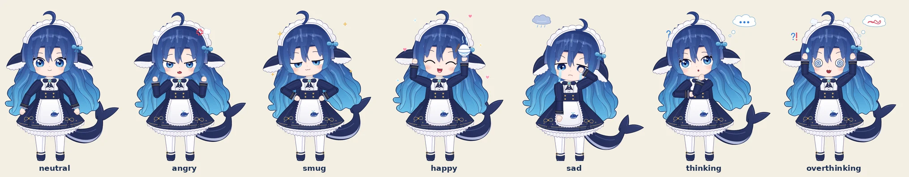

# Whale-chan 🐋🍚

A draggable, floating **DeepSeek whale maid** mascot delivered as a
reference-faithful, self-contained animated SVG. No frameworks, no build step,
no dependencies.



Whale-chan floats above the page with a gentle sway, a travelling light glint,
soft bubbles, and a small cloud of sparkles. Pick her up with a mouse, finger, or
stylus; she has momentum, edge bounce, position memory, and a serious rice habit.

> **Fan project.** Whale-chan is a community-created character, not an official
> DeepSeek mascot. DeepSeek and related marks belong to their respective owners.
> See [Licensing](#licensing) and [`reference/README.md`](reference/README.md).

## Run the demo

The page is static, but it needs to be served over HTTP so the browser can load
the SVG into the widget.

```bash
cd DeepseekMascot
python3 -m http.server 4173
# open http://localhost:4173
```

Any static server works — for example `npx serve .` or `php -S localhost:4173`.

## Desktop mascot (Linux, X11)

Whale-chan can also live on your desktop as a floating, transparent window:

```bash
python3 desktop/whalechan.py
```

Requirements: an X11 session with a compositor (GNOME, KDE, picom, …), Python 3,
PyGObject with GTK 3 and pycairo, and WebKit2GTK 4.0 (needed only for baking).
On Debian/Ubuntu: `sudo apt install python3-gi python3-gi-cairo gir1.2-webkit2-4.0`.

| Input | Behaviour |
| --- | --- |
| Drag | Pick her up; release to throw her with momentum |
| Left click | She says a line |
| Middle click | Feed her rice |
| Right click | Menu: say, feed, mood, size, opacity, glow, behaviour toggles, restart, hide, quit |
| Tray icon | Left click shows/hides her; right click opens the same menu |

How it works:

- **Baked frames.** WebKitGTK re-renders the CSS-rigged SVG on the CPU every
  frame (about one full core at 60 fps). Instead, [`desktop/bake.py`](desktop/bake.py)
  drives the SVG offscreen once per size: it retimes every idle loop so each mood
  loops seamlessly (7–8 s), snapshots every frame at 20 fps, and writes PNGs plus
  a click mask per mood to `~/.cache/whalechan/frames/<hash>/`. The first launch
  (or a new size) takes about a minute; the cache key changes when the SVG does.
- **Playback.** [`desktop/whalechan.py`](desktop/whalechan.py) is plain GTK and
  cairo with no WebKit at runtime. The current mood's frames are uploaded once as X server
  pixmaps, so playback is a server-side copy (~1–2% CPU).
- **Poof transitions.** Mood changes, waking up, appearing and hiding play an
  anime smoke poof: a squash-and-stretch bounce, white puffs and sparkles in the
  new mood's colour. The baked loops swap mid-squash, hidden by the smoke.
- **Click-through.** The window is small and moves with her. Its X11 input
  shape is her baked body silhouette, so clicks and scrolls next to her (and on
  floating effects like the thought bubble) reach the windows underneath.
- **Window.** An override-redirect popup: always on top, on every workspace,
  never focused, never tiled by Pop Shell, and absent from the taskbar and
  Alt-Tab. Pass `--managed` for a regular keep-above utility window instead.
- Settings (position, size, mood, opacity, glow) persist in
  `~/.config/whalechan/config.json`. Launching it again while it is running just
  wakes the existing instance.

### Desktop awareness

[`desktop/x11watch.py`](desktop/x11watch.py) watches the X11 desktop (window
stack, active window, workspaces, and input idle time via libXss). Each behaviour
can be toggled from **right-click → Behaviour**:

| Behaviour | What she does |
| --- | --- |
| Follow the cursor | In the neutral mood her eyes and head glance toward the pointer (left, right, up-left, up-right). She looks ahead again once it has been still for 6 s. |
| Stand on windows | Drop her near a window's top edge and she stands on it, riding along when you move the window. When it closes, minimizes, maximizes or leaves the workspace, she falls to the next window below or to the floor. |
| Comment on apps | Switching to some apps or tabs (YouTube, other AIs, code editors, terminals, Blender/Godot/Krita…) gets a remark. At most one every 3 min, and the same remark at most every 20 min. Only in the neutral mood. |
| Nap when you're away | After 4 min without input (`sleep_after` in the config) she switches to the `sleepy` mood (played at 10 fps). Any input, or a click on her, wakes her. |
| Hide for fullscreen apps | Off by default. When on, she disappears while the active window is fullscreen on her monitor (videos, games, slides) and comes back afterwards. |

Switching workspaces makes her glide in. Gaze is baked as extra `neutral-look-*`
states from CSS-variable overrides. They share neutral's loop period, so swapping
them mid-loop only moves her eyes and head. Each state's loop period is fitted to
the animations visible in it.
`python3 desktop/bake.py --preview sheet.png` renders one frame of every state into
a contact sheet, handy when tweaking the art.

### Control her from scripts

[`desktop/whalechan`](desktop/whalechan) is a small CLI with no GTK imports, so it
returns instantly. Symlink it onto your `PATH` if you like:
`ln -s "$PWD/desktop/whalechan" ~/.local/bin/whalechan`.

```bash
whalechan start                          # launch in the background (no-op if running)
whalechan say "Build passed" -m happy --for 8
whalechan mood thinking                  # neutral angry smug happy sad thinking waiting sleepy dance
whalechan mood thinking --strain 0       # hold a strain level instead of escalating
whalechan react success                  # working success failure error attention waiting resume idle
whalechan react fail "3 tests broke"     # aliases: start done pass fail crash input wait blocked …
whalechan run -- make test               # thinks while it runs, then cheers or sulks
whalechan move 600 300                   # place her; she perches if that's on a window top
whalechan sleep | wake
whalechan feed | show | hide | toggle | home | status | quit
```

- `react working` starts with the hand-on-chin thinking pose, thinks harder
  (hands on temples) after 5 min and has the overthinking meltdown after 10 min
  (`think_harder_after` / `think_stressed_after` in the config, in seconds).
  `success`/`failure`/`error` return to neutral after 8–10 s.
- `react waiting` is for being blocked on output (background agents, builds,
  another task): hands on hips, tapping her foot and glancing at the clock. She
  gets impatient (half-lidded pout, faster tapping) after 2 min and fumes
  (stomping, 💢) after 5 min (`wait_annoyed_after` / `wait_furious_after`).
  `react attention` is for being blocked on *you*: she hops, says so, and waits
  the same way. `react resume` ends a wait and goes back to thinking; it does
  nothing unless she is waiting, so it is safe to send often.
- Repeating `working` or `waiting` while she is already in that mood keeps her
  current level, so senders that repeat themselves don't calm her down.
- `react --quiet-line` changes mood without a speech bubble; `--key ID` drops
  repeats of the same key within 3 s (for senders that report events twice).
- `run` passes the command's exit code through, so it can wrap anything.
- If she isn't running, commands exit with status 3; add `-q` to exit 0 silently
  (useful in hooks).

Under the hood she listens on `$XDG_RUNTIME_DIR/whalechan.sock` (mode 600). Send
one request per line, as JSON or plain text, and get one JSON reply per line:

```bash
echo '{"cmd": "say", "text": "Hi", "mood": "happy"}' | socat - UNIX-CONNECT:$XDG_RUNTIME_DIR/whalechan.sock
echo 'react error Who broke the build?!'           | socat - UNIX-CONNECT:$XDG_RUNTIME_DIR/whalechan.sock
```

Git hook example (`.git/hooks/post-commit`):

```sh
#!/bin/sh
whalechan -q react success "Committed $(git log -1 --format=%h). Neat."
```

### Coding-agent reactions

**OpenCode.** [`integrations/opencode/whalechan`](integrations/opencode/whalechan/index.ts)
is a server plugin: she thinks while a session works, cheers with the session
title when a turn succeeds, gets angry when it fails, and hops when OpenCode asks
for permission or has a question. Subagent sessions are ignored. Install it
globally with a symlink (OpenCode loads `~/.config/opencode/plugins/` automatically):

```bash
ln -s "$PWD/integrations/opencode/whalechan" ~/.config/opencode/plugins/whalechan
```

**Claude Code.** Add hooks to `~/.claude/settings.json`:

```json
{
  "hooks": {
    "UserPromptSubmit": [{ "hooks": [{ "type": "command", "command": "whalechan -q react working --quiet-line 2>/dev/null || true" }] }],
    "Stop": [{ "hooks": [{ "type": "command", "command": "~/.claude/hooks/whalechan-react.sh success" }] }],
    "StopFailure": [{ "hooks": [{ "type": "command", "command": "whalechan -q react error 2>/dev/null || true" }] }],
    "Notification": [{ "hooks": [{ "type": "command", "command": "~/.claude/hooks/whalechan-react.sh attention" }] }]
  }
}
```

[`integrations/claude-code/whalechan-react.sh`](integrations/claude-code/whalechan-react.sh)
wraps `whalechan -q react` and keeps her quiet on Stop and idle prompts while
background agents or shells are still running, so she only cheers once the work
is really done. It asks a `bg-pending <transcript>` helper for the count
(`~/.claude/hooks/bg-pending` by default, or set `WHALECHAN_BG_PENDING`); without
the helper she reacts every time, as with plain `whalechan -q react`. Link it in:

```bash
ln -s "$PWD/integrations/claude-code/whalechan-react.sh" ~/.claude/hooks/whalechan-react.sh
```

Bake by hand, e.g. for another SVG with the same rig contract (`data-mood`,
`data-strain`, `.fx` effect layers):

```bash
python3 desktop/bake.py --svg path/to/mascot.svg --width 260 --fps 20
python3 desktop/whalechan.py --svg path/to/mascot.svg
```

## What is included

```text
.
├── index.html              demo landing page
├── styles.css              demo page styles
├── src/
│   ├── mascot.js           <deepseek-mascot> custom element
│   └── demo.js             demo controls + telemetry wiring
├── desktop/
│   ├── whalechan.py        X11 desktop mascot (GTK + cairo) + control socket
│   ├── whalechan           CLI: say, mood, react, run, …
│   ├── protocol.py         socket protocol shared by both
│   ├── x11watch.py         windows, active app, workspaces, idle time
│   └── bake.py             bakes the SVG rig into looping frames + click masks
├── integrations/
│   ├── claude-code/        Claude Code hook wrapper: quiet while background work runs
│   └── opencode/whalechan  OpenCode plugin: reacts to agent sessions
├── assets/
│   ├── whale-chan.svg      standalone rigged + animated vector SVG
│   ├── moods.json          mood registry read by the widget, demo and desktop app
│   ├── rig.json            art catalog (parts, pose variables, layers) for the editor
│   └── preview.webp        README preview
├── moods/                  one JSON file per mood + shared defaults/keyframes
├── editor/                 local web mood editor
├── tools/
│   ├── build_whale_chan.py generator for the SVG art (compiles moods/ via node)
│   ├── moods.mjs           mood compiler shared by the build and the editor
│   ├── compile_moods.mjs   CLI wrapper used by the build
│   └── editor_server.py    local server for the mood editor
└── reference/
    ├── README.md           image sources, attribution, licensing
    ├── isolated/           transparent reference art + cleaned master
    └── *.webp / *.png      full reference boards
```

## Use the mascot on another page

Copy `src/mascot.js`, `assets/whale-chan.svg` and `assets/moods.json` somewhere
your page can reach (keep `moods.json` next to the SVG), then:

```html
<script src="/path/to/mascot.js" defer></script>

<deepseek-mascot src="/path/to/whale-chan.svg"></deepseek-mascot>
```

The mood list, speech lines and accent colours come from `moods.json`. If it lives
elsewhere, point to it with `moods="/path/to/moods.json"`. Without it the widget
still works but only knows `neutral`'s theme. `whale.moods` lists the loaded moods
and `whale.moodsReady` is a promise that resolves once they are loaded.

The widget injects its own styles into a shadow root, so it will not collide with
the rest of the page. It can be placed anywhere in the document; visually it is
fixed to the viewport. Put it near the top of the body if you want it early in
the tab order.

### Sizing

```css
deepseek-mascot {
  --whale-size: 300px;   /* width; height follows the SVG */
  --whale-z: 9999;       /* stacking order */
}
```

On screens under 700px the default size is smaller. If you set `--whale-size`,
that value is used at every breakpoint.

## Interaction model

| Input | Behaviour |
| --- | --- |
| Drag | Moves the mascot with pointer capture; release throws her with velocity |
| Click / tap | Shows a random line in the speech bubble |
| `Enter` / `Space` | Shows a line (when the mascot is focused) |
| Arrow keys | Nudge by 18px; hold `Shift` for 48px |
| `Home` | Park her at the bottom-right edge |
| Viewport resize | Keeps her anchored to whichever edges she was nearest |

Positions are saved to `localStorage` under `whale-chan:position:v2`. The greeting
uses `sessionStorage` under `whale-chan:met:v2`, so she says hello once per
browser session.

## JavaScript API

```js
const whale = document.querySelector("deepseek-mascot");

whale.say("Custom line from your app.");
whale.speak("Alias of say().");
whale.setMood("happy");        // neutral | angry | smug | happy | sad | thinking | waiting | sleepy | dance
whale.setMood("sad", { announce: false }); // switch pose without a speech bubble
whale.mood;                    // current mood
whale.feed();                  // rice particles + a random rice-related line
whale.resetPosition(true);     // park her, optionally announce it
whale.position;                // { x, y } in viewport pixels
```

Events bubble out of the custom element:

```js
whale.addEventListener("whale-move", (event) => {
  console.log(event.detail); // { x, y, xPct, yPct }
});

whale.addEventListener("whale-speak", (event) => {
  console.log(event.detail.text);
});

whale.addEventListener("whale-feed", (event) => {
  console.log(event.detail.count);
});

whale.addEventListener("whale-mood", (event) => {
  console.log(event.detail.mood);
});

// "thinking" and "waiting" escalate on their own: strain 1 after ~2.8s, strain 2 after ~6.8s
whale.addEventListener("whale-strain", (event) => {
  console.log(event.detail.mood, event.detail.strain);
});
```

## Animation & Vector Art

The mascot is a **pure vector, hand-rigged SVG**: no embedded bitmaps or base64
images, so it stays crisp at any size. Every body part sits in its own pivot
group, so CSS can pose and animate it independently:

| Joint / layer | Classes | Pivot |
| --- | --- | --- |
| Whole body (hops, stomps, sways) | `.char-pose` › `.char-anim` | feet |
| Breathing torso | `.upper-anim` | — |
| Head (back hair and face move together) | `.head-pose` › `.head-anim` | neck |
| Shoulders / elbows | `.arm-l`, `.arm-r` › `.u-pose` › `.u-anim` › `.f-pose` › `.f-anim` | shoulder, elbow |
| Tail and fluke | `.tail-pose` › `.tail-wag` › `.fluke` | tail root, fluke base |
| Fin-ears, ahoge, brows, irises | `.ear`, `.ahoge`, `.brow-l/r`, `.iris-pose` | each part |
| Sleepy plush | `.pillow` › `.pillow-squish` | plush bottom |
| Expression layers | `.lid-*`, `.eye-happy`, `.eye-squeeze`, `.eye-swirl`, `.eye-sleep`, `.m-*` mouths | — |

Each mood is a **full-body pose**, not just a face swap:

| Mood | Body | Face & effects |
| --- | --- | --- |
| `neutral` | holds her skirt like the reference art, floats and breathes | soft smile, blinking |
| `angry` | fists up and pumping, stomping, tail thrashing, fins flared | slanted lids, fang, 💢 mark, steam puffs |
| `smug` | hands on hips, chin up, slow proud sway and tail swish | half-lidded side-eye, cat mouth, sparkles |
| `happy` | hopping, cheering with a steaming rice bowl held high, fast tail wag | ^ ^ eyes, open smile, hearts and stars |
| `sad` | slumped and sobbing, rubbing one eye, tail and ahoge drooping | teary eyes, wobbly mouth, tear streams, rain cloud |
| `thinking` (`data-strain="0"`) | hand on chin, other arm across her body, tapping | glance up, "o" mouth, thought bubble, `?` |
| `thinking` (`data-strain="1"`) | hands pressed to her temples, shaking | `> <` eyes, sweat drop |
| `thinking` (`data-strain="2"`) | overthinking: arms flailing, vibrating, spinning ahoge | swirl eyes, steam, scribbled thought, `?!` |
| `waiting` (`data-strain="0"`) | hands on hips, elbows out, patiently tapping one foot | glancing up at the clock, small smile |
| `waiting` (`data-strain="1"`) | impatient: faster tapping, head shaking, ears drooping | half-lidded side-eye, pout |
| `waiting` (`data-strain="2"`) | fuming: stomping both feet, vibrating, tail thrashing | angry lids, fang, 💢 mark, steam puffs |
| `sleepy` | dozing on her feet hugging a whale plush; slow breathing, head nods off and jerks back up | closed eyes, breathing "o" mouth, snot bubble, floating Z's |
| `dance` | 8-count loop: one fist thrown up and pumped while the opposite leg steps out, then the other side; bounces on every count | happy closed eyes, open smile, floating music notes |

Poses are CSS custom properties on the SVG root (for example `--lu`/`--lf` for the
left shoulder and elbow angles, `--hr` for head tilt, `--tail`, `--ahoge`), and each
pose part has a springy `transition`. Switching moods therefore animates smoothly
between poses instead of snapping. A separate keyframe loop on the inner `*-anim`
group adds the idle motion on top.

The art is generated by [`tools/build_whale_chan.py`](tools/build_whale_chan.py).
It is traced in the coordinate space of
[`reference/isolated/whalechan-art-master.webp`](reference/isolated/whalechan-art-master.webp)
(silhouettes were checked against the reference alpha mask) and drawn in the
reference's anime style: tapered hair locks with cel shading and gloss, layered
irises with winged lashes, and line art tinted to each material.

Moods are data, not code. Each one is a JSON file in [`moods/`](moods/README.md)
holding its pose (hand targets solved with two-bone IK, plus pose variables),
visible face/effect layers, keyframe motion per body part, strain variants and
theme (label, speech line, button icon, colours). The build compiles them with
[`tools/moods.mjs`](tools/moods.mjs), the same compiler the editor uses for its
live preview, and writes the SVG, `assets/moods.json` and `assets/rig.json`.
Needs Python 3 and Node:

```bash
python3 tools/build_whale_chan.py   # rewrites assets/whale-chan.svg, moods.json, rig.json
```

A new mood shows up everywhere after a build: widget, demo buttons, desktop app,
CLI and the desktop frame baker.

## Mood editor

Create and tweak moods in the browser instead of editing JSON:

```bash
python3 tools/editor_server.py --open   # http://127.0.0.1:8765/editor/ (localhost only)
```

- **Pose**: drag her hands on the preview (IK solves the elbow), toggle fists,
  and use sliders for head tilt, brows, gaze, fin-ears, ahoge, tail, blush and body squash.
- **Face & layers**: pick eyes and mouth, and toggle lids, tears, effects, props and thought bubbles.
- **Timeline**: one track per body part with draggable keyframes, a scrubbable playhead,
  per-track duration/delay/easing (with a curve editor), per-stop easing, and hand
  keyframes you place by dragging the hand at the playhead.
  - **Beat helpers**: set BPM × counts to snap to the beat.
  - **Mirror to other side**: copy a track to the opposite arm or leg, optionally half a loop later (this is how `dance` alternates sides).
  - **Bake badge**: shows the loop period the desktop baker will use and warns about tracks that won't loop cleanly.
- **Variants**: edit per-strain overrides (like `thinking`'s escalation).
- **Meta**: label, speech line, button icon and theme colours for the web page and desktop app.
- **Save and Build**: Save writes `moods/<name>.json` (checked by the compiler first).
  Build regenerates the SVG and registries. Undo/redo, Ctrl+S, Space to play.

The editor's internals and extension points are described in [`editor/README.md`](editor/README.md).

Dragging pauses the SVG animations (`.is-paused`). `prefers-reduced-motion` and the
`.reduce-motion` class stop all loops but keep each mood's static pose.

The widget adds the breathing aura, floor shadow, drag momentum, feed hop, speech bubble, and rice particles. Inertia is also disabled when reduced motion is requested.

## Accessibility notes

- The mascot is a real `<button>` inside a shadow root, with an explicit label.
- It appears early in the tab order; `Enter` and `Space` are handled explicitly.
- A visible `press enter` badge appears on keyboard focus.
- Arrow-key movement does not trap focus.
- The speech bubble is an `aria-live="polite"` status region.
- Decorative SVG, orbit text, and sparkles are hidden from assistive technology.
- Reduced-motion preferences remove non-essential movement.

## Licensing

The **code** (`index.html`, `styles.css`, `src/*.js`) is released under the MIT
License — see [`LICENSE`](LICENSE).

The **character artwork** (`assets/whale-chan.svg`) is an original, hand-crafted
vector illustration adapted from the community **Whale-chan / 鲸鱼娘** reference
[`neutral_standing_front_isolated.webp`](reference/isolated/neutral_standing_front_isolated.webp),
with original SVG animation and presentation built around it. The reference
library by [Neko3000/deepseek-whalechan](https://github.com/Neko3000/deepseek-whalechan)
(and the original "Mingyue" character by **Shangshan Wuxing**) is shared under
**CC BY-NC-SA 4.0**. As a derivative fan work, the illustration is distributed
under the same **CC BY-NC-SA 4.0** terms: attribution required, non-commercial
use only, share adaptations under the same license.

The visual reference images live in [`reference/`](reference/README.md).
The SVG is fully self-contained vector art, so runtime use needs only
`assets/whale-chan.svg` plus `src/mascot.js`.
